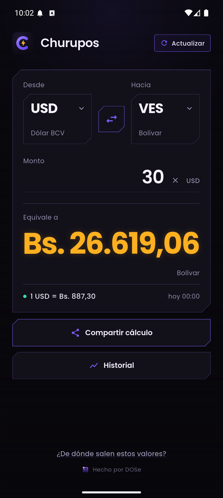
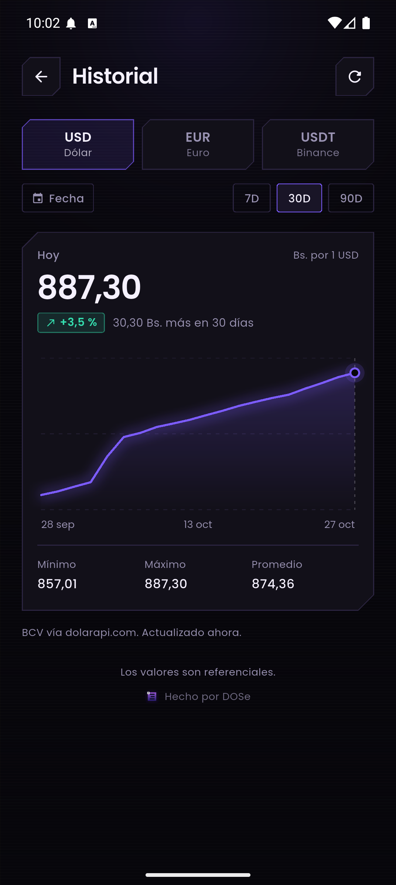

# Churupos

Calculadora de cambio de divisas para Venezuela. Convierte entre bolívares, dólar BCV, euro BCV y
USDT de Binance P2P en una sola pantalla. Sin cuentas, sin backend propio y sin publicidad.

| Conversor | Historial |
|---|---|
|  |  |

**Versión:** 1.0.7+8 · **Paquete:** `com.isdose.churupos` · **Android:** 7.0+
**Web:** [churupos.isdose.com](https://churupos.isdose.com)

## Qué hace

- Convierte entre `VES`, `USD BCV`, `EUR BCV` y `USDT Binance`.
- Elige origen y destino con dos selectores; el botón central los intercambia.
- Escribe el monto y el resultado aparece al instante, con formato venezolano.
- Toca el resultado para copiarlo al portapapeles.
- El botón de reinicio vuelve al cálculo por defecto: 1 dólar BCV a bolívares.
- Historial de 7, 30 o 90 días con gráfico, variación, mínimo, máximo y promedio.
- Consulta puntual de una fecha del histórico.
- Comparte una captura del cálculo con el texto, la tasa y el enlace de la app.
- Sin conexión usa la última tasa guardada y muestra la hora a la que corresponde.
- Si Binance falla, BCV sigue funcionando y USDT queda marcado como sin datos.

Google Play: próximamente.

## De dónde salen los valores

- **Dólar y euro BCV:** `GET https://ve.dolarapi.com/v1/cotizaciones`, publicado por
  [dolarapi.com](https://ve.dolarapi.com) a partir del Banco Central de Venezuela.
- **Histórico del BCV:** `GET https://ve.dolarapi.com/v1/historicos/dolares` y
  `.../historicos/euros`. Se descarga la serie completa (desde 2023), se recorta a 120 días y se
  guarda 6 h en el teléfono. Para una fecha puntual se usa
  `.../historicos/dolares/AAAA/MM/DD` y el equivalente de euros.
- **USDT/Binance:** `POST https://p2p.binance.com/bapi/c2c/v2/friendly/c2c/adv/search` con
  `tradeType: BUY` (anuncios que venden USDT). La app promedia los 10 primeros precios válidos.
  Es un endpoint público no oficial y puede cambiar sin aviso. Binance no publica histórico P2P,
  así que Churupos guarda un valor por día para construir el suyo.

Churupos no fija, compra ni vende divisas. Los valores son referenciales.

## Desarrollo

```powershell
flutter pub get
flutter run          # con un emulador o teléfono conectado
flutter test
flutter analyze
flutter build apk --release
```

Requisitos: Flutter 3.47+, Android SDK 36, Java 17+.

La web vive en `landing/` y es HTML/CSS estático, sin build. El hero abre
**“Probar versión web”**, un modal con un conversor limitado a **USD y EUR BCV**. No incluye
USDT, historial, compartir ni modo offline: para eso está la app. Llama a dolarapi directo y
cachea las tasas en `localStorage`, así que no necesita backend ni proxy.

```powershell
python -m http.server 4173 --directory landing
# http://127.0.0.1:4173/
```

El despliegue de la landing es manual: se sube el contenido de `landing/` al hosting.

## Stack

Flutter · Riverpod · Dio · SharedPreferences · Poppins local · tema oscuro con paneles
chamferados.

## Autor

Hecho por DOSe. [isdose.com](https://isdose.com)
