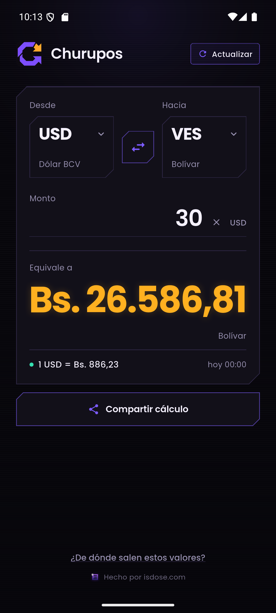
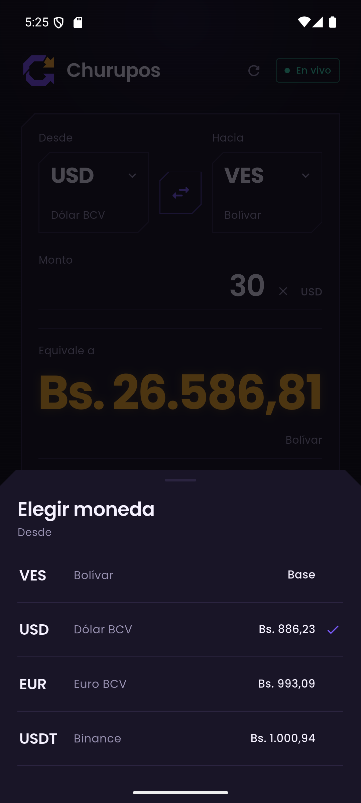
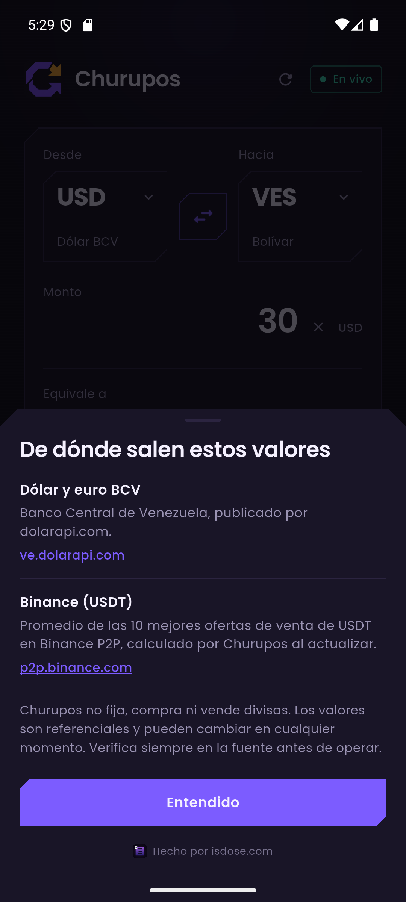
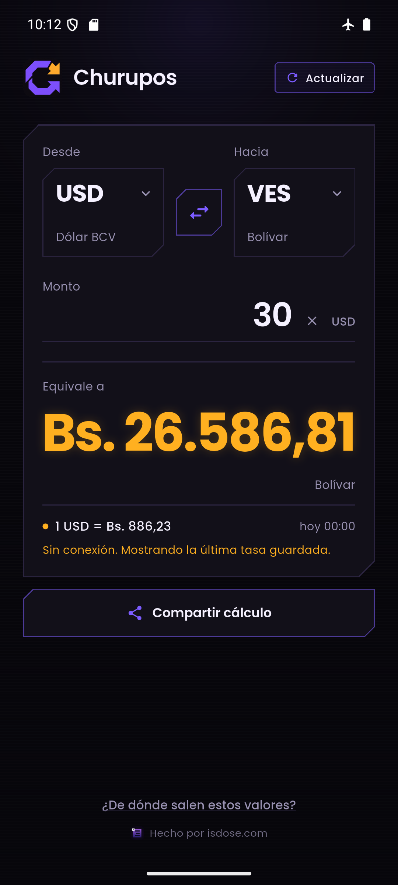
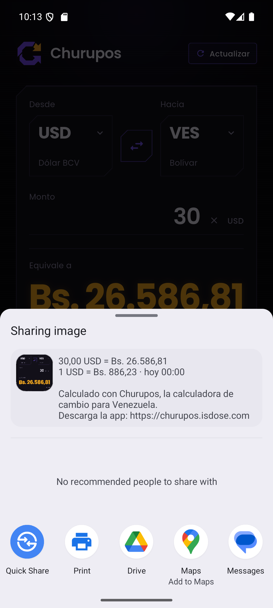
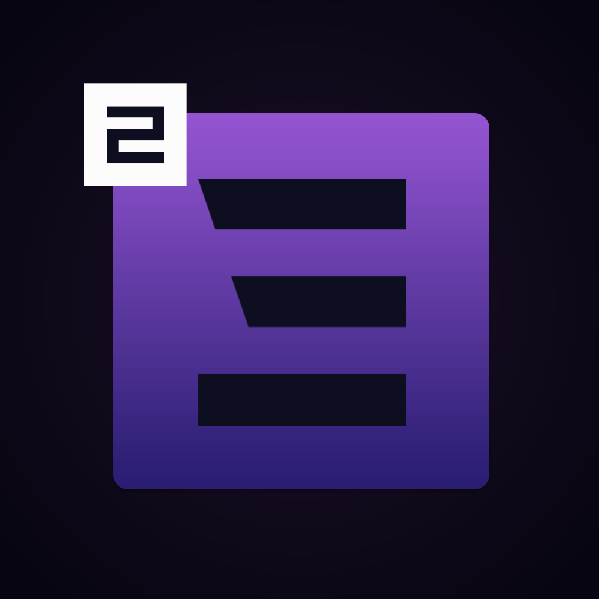

# Churupos

Calculadora de cambio de divisas para Venezuela. Convierte entre bolívares, dólar BCV,
euro BCV y USDT de Binance P2P en una sola pantalla, sin cuentas y sin backend propio.

**Versión:** 1.0.1+2 · **Paquete:** `com.isdose.churupos` · **Android:** 7.0+ (minSdk 24)



## Instalar

APK listo para probar: [`dist/churupos-1.0.1.apk`](dist/churupos-1.0.1.apk)

```powershell
adb install -r dist/churupos-1.0.1.apk
```

El APK está firmado con la clave de depuración: sirve para probar en un teléfono, no para
publicar en Play Store.

## Qué hace

- Convierte entre `VES`, `USD BCV`, `EUR BCV` y `USDT Binance`.
- Elige origen y destino con dos selectores; el botón central los intercambia.
- Escribe el monto y el resultado aparece al instante, con formato venezolano.
- Comparte una captura del cálculo con el texto, la tasa y el enlace de descarga.
- Botón **Actualizar** en el encabezado, refresco automático cada 5 minutos y al volver a la app.
- Sin conexión usa la última tasa guardada y muestra la hora a la que corresponde.
- Si Binance falla, BCV sigue funcionando y USDT queda marcado como sin datos.
- El botón del pie explica las fuentes y el descargo.

| Monedas | Fuentes | Sin conexión |
|---|---|---|
|  |  |  |

Al compartir, Churupos adjunta una captura del cálculo y este texto:

```text
30,00 USD = Bs. 26.586,81
1 USD = Bs. 886,23 · hoy 14:35

Calculado con Churupos, la calculadora de cambio para Venezuela.
Descarga la app: https://churupos.isdose.com
```



## De dónde salen los valores

- **Dólar y euro BCV:** `GET https://ve.dolarapi.com/v1/cotizaciones`, publicado por
  [dolarapi.com](https://ve.dolarapi.com) a partir del Banco Central de Venezuela.
- **USDT/Binance:** `POST https://p2p.binance.com/bapi/c2c/v2/friendly/c2c/adv/search` con
  `tradeType: BUY` (anuncios que venden USDT). La app promedia los 10 primeros precios válidos.
  Es un endpoint público no oficial y puede cambiar sin aviso.

Churupos no fija, compra ni vende divisas. Los valores son referenciales.

## Desarrollo

```powershell
flutter pub get
flutter run          # con un emulador o teléfono conectado
flutter test         # 51 tests
flutter analyze      # sin issues
flutter build apk --release
```

Requisitos: Flutter 3.47+, Android SDK 36, Java 17+.

### Icono y versiones

El icono se dibuja por código en `scripts/generate_app_icon.py` (anillo "C" violeta, rayo
ámbar y fondo con degradado). Tras cambiar el diseño:

```powershell
python scripts/generate_app_icon.py     # reescribe assets/branding/*
dart run flutter_launcher_icons         # regenera los mipmap/drawable de Android
```

Cada entrega sube el último dígito de la versión: `1.0.1`, `1.0.2`, `1.0.3`... y el
`versionCode` de `pubspec.yaml` sube en uno.

### Estructura

```
lib/
  core/                 tema, tipografía, formato de dinero y entrada
  features/converter/
    domain/             monedas, tasas, conversión pura
    data/               clientes de dolarapi y Binance, caché, repositorio
    presentation/       pantalla, hojas y widgets
    providers.dart      Riverpod + estado del par y del resultado
assets/
  branding/             logo de Churupos, iconos de launcher e isdose
  fonts/                Poppins 300–800
scripts/
  generate_app_icon.py  dibuja la marca y regenera los PNG del icono
test/                   dominio, formato, promedio, repositorio y widget
```

### Decisiones

- **Riverpod** sin codegen; dominio puro y testeable.
- **Dio** con timeout de 8/10 s y reintento único en errores de red.
- **share_plus + path_provider** para capturar el panel y compartirlo como PNG con texto.
- **SharedPreferences** para el último par, el monto y el snapshot de tasas.
- **Poppins** incluida en assets; no se descarga en tiempo de ejecución.
- Todo el cálculo pasa por bolívares (`monto × VES_origen ÷ VES_destino`).
- Caché por fuente: un fallo de Binance no oculta BCV.

### Pruebas

51 tests cubren las 12 conversiones, ida y vuelta, formato `es-VE`, límites del campo,
promedio de Binance, fusión de fuentes con caché, texto para compartir y los flujos
principales de la pantalla.

## Estado

Listo para probar en Android. Pendiente para una publicación:

- Firma de release propia y revisión de Play Store.
- Sustituir el endpoint no oficial de Binance por un proveedor con contrato si se necesita
  estabilidad a largo plazo.
- Historial, alertas o widgets, si algún día hacen falta.

## Autor

Hecho por [isdose.com](https://isdose.com).



La especificación completa está en [`specs.md`](specs.md).
